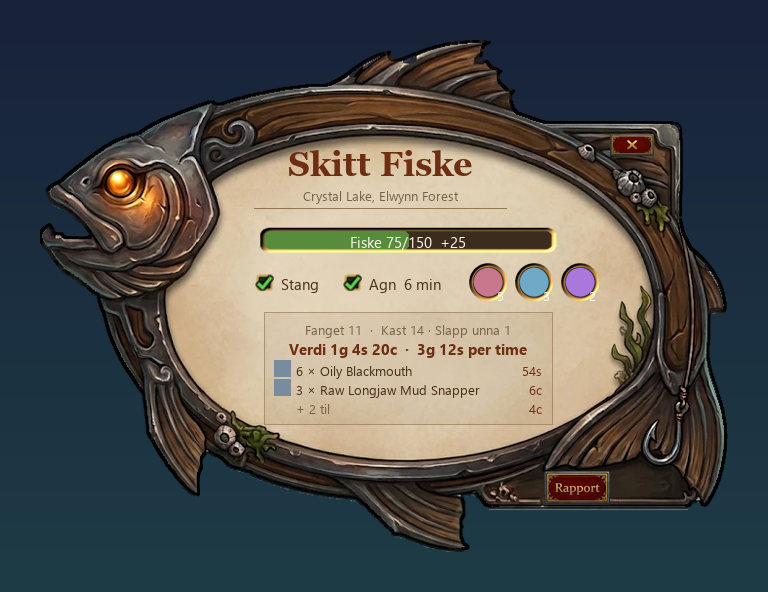

# Skitt Fiske

Fiske uten mas i WoW Forever. Én knapp på baren starter, og samme knapp avslutter.

## Slik bruker du den

1. Første gang du logger inn med addonen, lages makroen **Skitt Fiske**. Skriv `/skitt makro`, så ligger den på musa.
   Klikk den på en ledig plass på baren.
2. **Trykk på knappen:** Det beste fiskeutstyret du har, tas på (stang, hatt, støvler …). Lyden settes opp, så du hører
   plasket, også når du er ute av spillet. Fiskevinduet åpnes.
3. **Dobbelt høyreklikk** på vannet kaster. **Høyreklikk på duppen** når den plasker, så får du fisken.
4. **Agn:** Hvert agn du har i baggen, står som en rund knapp nederst i vinduet. Klikk, så settes det på stanga. Ringene
   lyser når agnet holder på å gå ut.
5. **Trykk på knappen igjen** (eller krysset i vinduet): Det gamle utstyret og lyden din kommer tilbake. Fangsten lagres
   som en rapport (tid, kast, fisk, skill og hva den er verdt). Trykk **Rapport** for å se den, og bla med pilene.

Vinduet viser fiskeskillen, fangsten og hva den er verdt mens du fisker. **Klikk på områdenavnet**, så ser du hva som kan
fanges der, sjansen per fangst, hvilken fiskeskill området krever og din sjanse for at fisken ikke slipper unna.

Blir du angrepet mens du fisker, kommer våpnene på med én gang når du trykker på knappen. Resten kommer på når
kampen er over. **Shift + rull** over vinduet gjør det større eller mindre.

Har du [Sparkmack's Kurstidende](https://github.com/Romkapsel/sparkmacks-kurstidende), regnes verdien med normalkursen i
AH. Ellers brukes det vendoren betaler.

## Kommandoer

`/skitt` start eller avslutt · `/skitt makro` makroen på musa · `/skitt rapport` siste fangst · `/skitt debug` feilsøking

## Lisens

GPL-3.0 – se [LICENSE](LICENSE). Fiskedataene (hva som kan fanges og fiskenivå per område) kommer fra
[CMaNGOS Classic-databasen](https://github.com/cmangos/classic-db), som også er GPL-3.0. Fiskerammen og knappene er laget
for Skitt Fiske.
